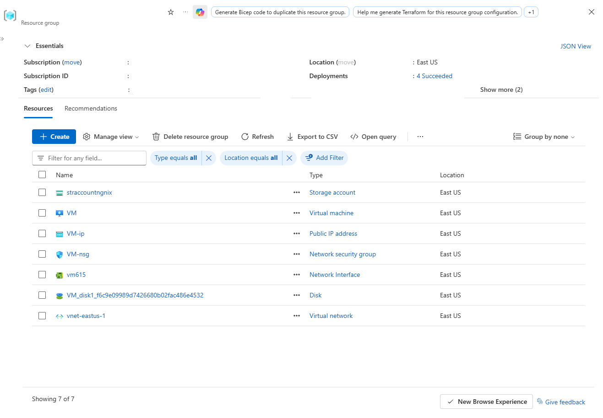
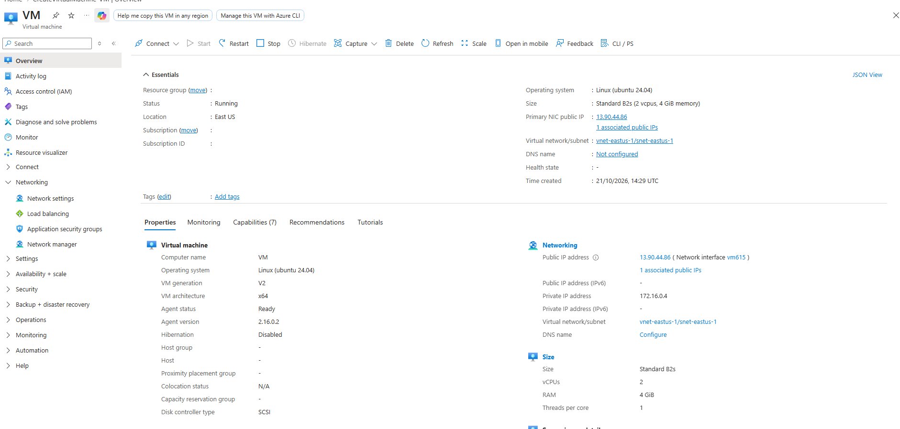
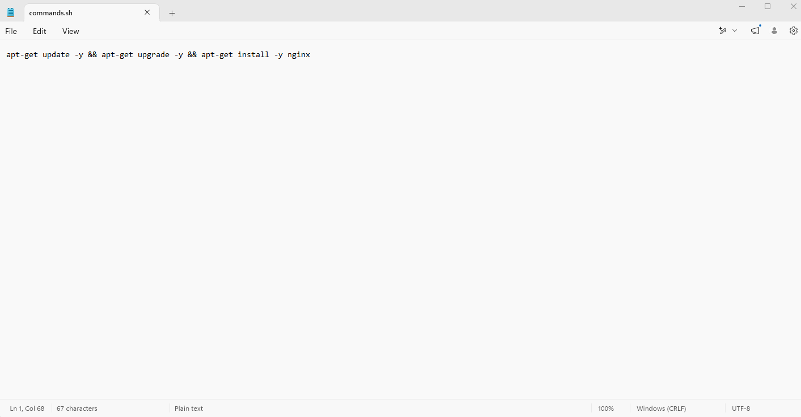
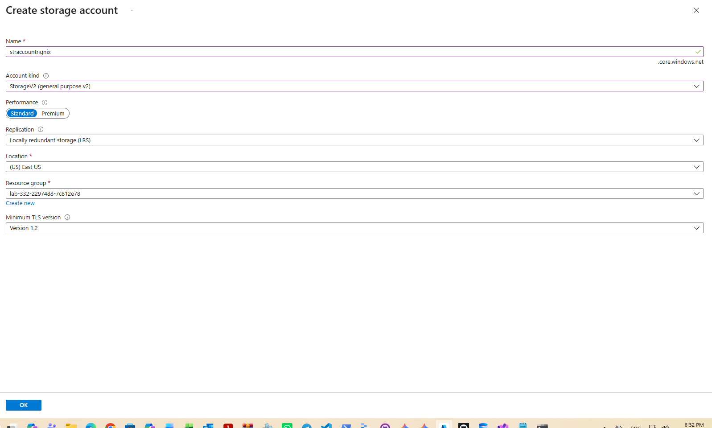
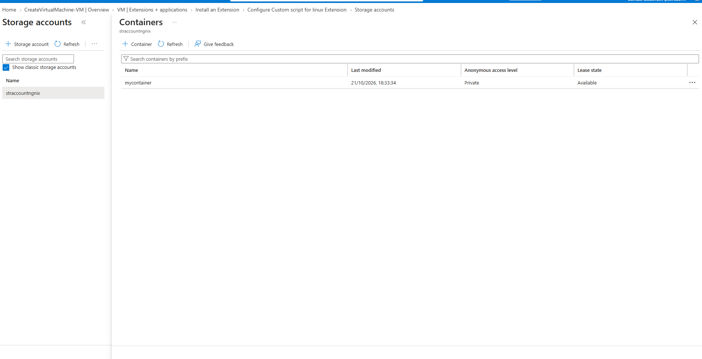
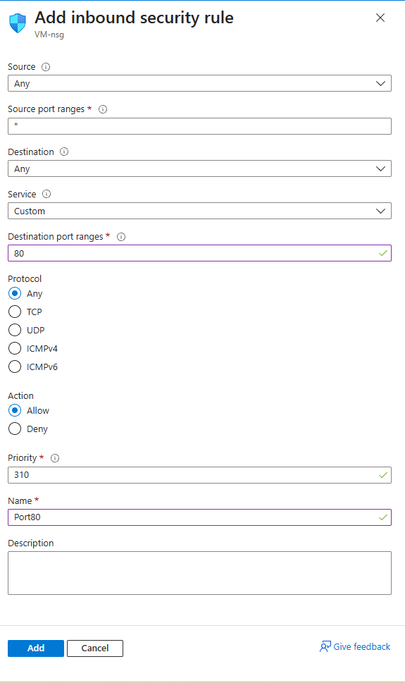
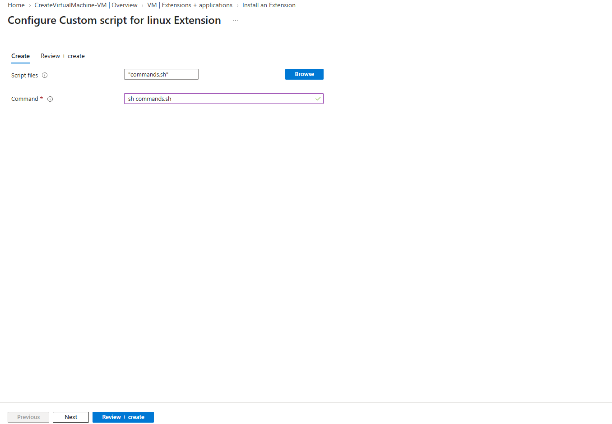
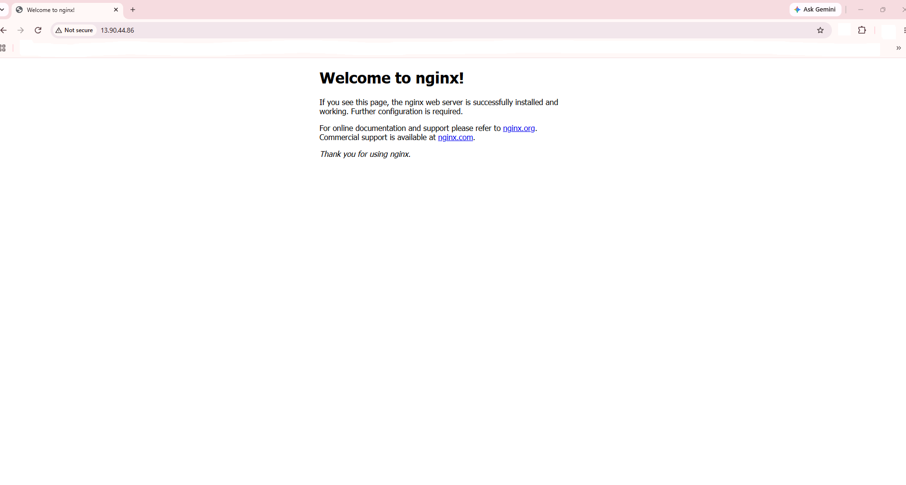

# Automating NGINX Web Server Deployment on Azure via Custom Script Extensions

Comprehensive infrastructure configuration detailing the automated provisioning of an NGINX web server on an Azure Ubuntu 24.04 LTS virtual machine using Azure Storage and Custom Script Extensions.

---

## 1. Architecture & Provisioned Resources

### Core Infrastructure Topology

| Resource Type | Resource Name | Specification / Tier | Region / Location |
| :--- | :--- | :--- | :--- |
| **Virtual Machine** | `VM` | Standard_B2s, Ubuntu 24.04 LTS (Trusted Launch) | East US |
| **Virtual Network** | `vnet-eastus-1` | `172.16.0.0/16` (`snet-eastus-1`: `172.16.0.0/24`) | East US |
| **Public IP Address** | `VM-ip` | Static Standard IPv4 (`13.90.44.86`) | East US |
| **Network Security Group** | `VM-nsg` | Inbound Rules: SSH (22), Port80 (80) | East US |
| **Network Interface** | `vm615` | Dynamic Private IP (`172.16.0.4`) | East US |
| **Storage Account** | `straccountngnix` | Standard_LRS, StorageV2 | East US |
| **Blob Container** | `mycontainer` | Private Access Level | East US |
| **VM Extension** | `CustomScript` | Microsoft.Azure.Extensions.CustomScript (v2.0) | East US |

---

### Provisioned Environment Validation

*Resource group overview confirming successful provisioning of the virtual machine, storage account, public IP, network security group, network interface, OS disk, and virtual network.*

---

*Virtual machine overview pane showing VM running Ubuntu 24.04 LTS with public IP address 13.90.44.86.*

---

## 2. Step-by-Step Implementation

### Step 1: Prepare Shell Automation Script

Created a bash deployment script named `commands.sh` containing shell instructions to update package indexes, upgrade installed packages, and install the NGINX web server.

*Shell script contents detailing the non-interactive package update, upgrade, and NGINX installation sequence.*

---

### Step 2: Provision Azure Storage Account

Created a General Purpose v2 storage account named `straccountngnix` to securely host the custom configuration script.

*Creating the Standard_LRS storage account straccountngnix in East US.*

---

### Step 3: Create Blob Container and Upload Script

Configured a private blob container named `mycontainer` within `straccountngnix` and uploaded `commands.sh`.

*Container overview displaying private blob container mycontainer in straccountngnix.*

---

### Step 4: Configure Network Security Group Inbound Rule

Added an inbound security rule named `Port80` to `VM-nsg` allowing traffic on destination port 80.

*Inbound security rule configuration allowing TCP traffic over HTTP port 80 with priority 310.*

---

### Step 5: Execute Custom Script Extension on Virtual Machine

Attached the Custom Script Extension for Linux to `VM`, referencing `commands.sh` stored in Azure Storage, and executed the target shell command.

*Configuring the CustomScript extension with target script commands.sh and execution command sh commands.sh.*

---

### Step 6: Validate NGINX Web Server Deployment

Accessed the virtual machine's public IP address (`13.90.44.86`) in a web browser to verify that the NGINX landing page is successfully delivered.

*Successful HTTP validation rendering the default Welcome to nginx! page via the provisioned public IP.*
